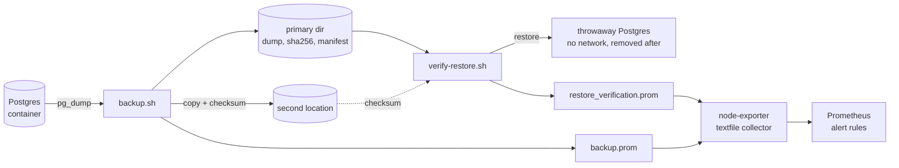

# backup-restore-verification

[](https://github.com/Walaskien/backup-restore-verification/actions/workflows/ci.yml)

A backup nobody has restored is not a backup yet. The cron job says "done", the dump file has a plausible size, and the first time anyone learns it is truncated or empty is the day the database is gone.

This repo is a small Postgres setup that closes that gap: it takes a backup on a schedule, and then restores the newest one into a throwaway container and checks that the data came back. The result goes to Prometheus, so a backup that cannot be restored raises an alert instead of sitting there looking fine.

Bash scripts, Docker, Prometheus rules with `promtool` tests, a runbook, and a CI workflow that runs the whole cycle, including deliberately broken backups.

It is a reference implementation built around a demo database. Read the Limitations before pointing it at anything you care about.

## How it works



`backup.sh`:

1. `pg_dump` in custom format (compressed) from the running container, written to a temporary directory.
2. A `.sha256` file next to it, and a `.manifest` with a row count and a data checksum for each control table (`VERIFY_TABLES`), read from the source database.
3. The dump is moved into place last, so a half-finished backup is never picked up as "newest".
4. Copy to the second location, checksum checked again there.
5. Rotation: dumps older than `RETENTION_DAYS` are removed, but the newest `MIN_KEEP` are never touched, so a week of failing runs cannot rotate away the last good backups.

`verify-restore.sh`:

1. Take the newest dump, check its checksum, check that the manifest exists, check the copy in the second location.
2. Start a Postgres container with no network, restore into it with `pg_restore --exit-on-error`.
3. Run the same row count and data checksum queries on the restored database and diff them against the manifest.
4. Remove the container (also when something failed), write the metrics.

The exit code says where it stopped (11 checksum, 12 restore, 13 data differs, 14 second copy), which is what the runbook starts from.

## Quick start

Needs Docker and `make`; the e2e scripts also use `curl`, `jq` and `python3`. Ports used on the host: 15632 (Postgres) and 19690 (Prometheus), both on 127.0.0.1.

```console
make up         # Postgres with seed data, node-exporter, Prometheus
make backup
make verify
cat data/metrics/*.prom
```

With only docker-compose v1 installed: `make up COMPOSE=docker-compose`.

Prometheus is at http://127.0.0.1:19690. The full cycle with the broken-backup cases (it wipes `data/backups` and the metrics files first):

```console
make e2e
make down       # removes containers and volumes, `make clean` also deletes ./data
```

On a schedule (paths are an example):

```cron
0 2 * * *   cd /opt/backup-restore-verification && scripts/backup.sh >> /var/log/brv.log 2>&1
30 2 * * *  cd /opt/backup-restore-verification && scripts/verify-restore.sh >> /var/log/brv.log 2>&1
```

For your own database set `PG_CONTAINER`, `PG_USER`, `PG_DB`, `VERIFY_TABLES` and the directories, see the settings table in the [runbook](docs/runbook.md#settings). Pick tables whose contents you would notice missing.

## Metrics and alerts

Written to `data/metrics/*.prom` and picked up by node-exporter's textfile collector.

| Metric | Meaning |
|---|---|
| `backup_last_success_timestamp_seconds` | last time a dump was written and read back correctly; kept across failed runs |
| `backup_last_run_success` | 1 or 0 for the latest run |
| `backup_size_bytes` | size of the newest dump |
| `backup_duration_seconds` | wall time of the latest run |
| `backup_secondary_copy_success` | newest dump reached the second location with a matching checksum |
| `restore_verification_success` | 1 if the newest backup restored and matched the manifest |
| `restore_verification_duration_seconds` | wall time of the latest verification |
| `restore_verification_last_run_timestamp_seconds`, `..._last_success_timestamp_seconds` | when it last ran, and when it last passed |

Rules in `prometheus/rules/backup.yml`, thresholds assume a daily schedule:

- `BackupStale`: no successful backup for 26 hours
- `BackupRunFailed`: the latest run failed
- `BackupSecondaryCopyFailed`: the newest dump is not in the second location
- `BackupSizeDropped`: newest dump is under half of the 7 day average
- `RestoreVerificationFailed`: the newest backup could not be restored or did not match
- `RestoreVerificationStale`: no successful verification for 50 hours
- `BackupMetricsAbsent`: the metrics disappeared, so the others would stay silent

Each has a section in the [runbook](docs/runbook.md): symptom, what to check, what to do.

## Verified

Run on macOS with Colima (Docker Engine 29.5.2, docker-compose 1.29.2), Postgres 16 images, Prometheus v2.55.1, node-exporter v1.8.2:

| Check | Result |
|---|---|
| `shellcheck` 0.10.0 on `scripts/*.sh` and `tests/*.sh` | no findings |
| `ruff check`, `ruff format --check`, `pytest` (Python 3.9 and 3.12) | clean, 24 tests passed |
| `promtool check config`, `check rules`, `test rules` | 7 rules, all unit test cases pass; raising the `BackupStale` threshold in a copy makes the tests fail, so they do test something |
| `actionlint` 1.7.7 on `.github/workflows/ci.yml` | no findings |
| `make e2e` from an empty state (no volumes, no `data/`) | 32 checks passed, about 1 minute 45 seconds |

What `make e2e` covers:

- backup, add rows, backup again; the manifest of the newest one has the new row count; verification picks the newest dump and passes; no temporary container is left behind;
- rotation with a backdated dump removes it (with its checksum and manifest) from both locations and keeps the rest;
- Prometheus reports `restore_verification_success 1` and nothing is firing;
- three broken backups, each has to fail verification with its own exit code, set `restore_verification_success` to 0 and leave the last success timestamp alone: flipped bytes (exit 11), a truncated dump whose checksum was recomputed so only a real restore notices (exit 12), and a dump that restores cleanly but comes from a database that lost some rows (exit 13, the log shows the diff against the manifest);
- the first case makes `RestoreVerificationFailed` fire in the running Prometheus, and a good backup afterwards clears it.

Separately, by hand: a missing second location gives exit 13 from `backup.sh` and `backup_secondary_copy_success 0`; a missing second copy gives exit 14 from the verification.

The workflow runs the same commands on a GitHub-hosted runner, where the shell scripts meet GNU userland instead of macOS. That part is not something I ran locally.

The demo database is about 42,000 rows and a 400 KB dump, so the timings above say nothing about the restore time of a real database.

## Limitations

- Postgres in a Docker container only. The scripts use `docker exec`; for a host or remote Postgres the dump and query calls would need to change.
- The manifest is read right after the dump, not in the same snapshot. If the control tables take writes while the backup runs, the counts can differ and verification fails for a good backup. `pg_dump --snapshot` with an exported snapshot would remove the race, it is not implemented.
- Only the tables in `VERIFY_TABLES` are compared, and the data checksum is built in memory with `string_agg`, which suits small control tables, not big ones. A damaged table outside the list can still pass.
- In the demo the second location is a directory on the same disk. Real 3-2-1 needs another disk or host, plus one copy off site; this repo only does the second copy and the checking of it.
- Plain dumps, so recovery point equals the backup interval. No WAL archiving, no point-in-time recovery, no encryption of the dump files.
- No Alertmanager or notification channel in the compose file, only Prometheus rules. Thresholds fit a daily schedule and have to be adjusted for another one.
- Two verifications running at the same moment are not supported.
- Passwords in the compose file are demo values, the container is bound to localhost.
- The Linux side is covered by the CI workflow, not by my local runs.

## Layout

```
scripts/
  backup.sh             dump, checksum, manifest, second copy, rotation, metrics
  verify-restore.sh     restore into a throwaway container and compare
  add-orders.sh         adds rows to the demo database
  lib.sh                shared functions and defaults
db/init/                schema and deterministic seed data
prometheus/
  prometheus.yml
  rules/backup.yml      alert rules
  tests/backup_test.yml promtool unit tests
tests/
  test_scripts.py       pytest, parts that need no Docker
  e2e_happy_path.sh     full cycle with rotation
  e2e_corrupted_backup.sh   broken backups must fail and alert
docs/runbook.md
docker-compose.yml      Postgres, node-exporter (textfile), Prometheus
Makefile
.github/workflows/ci.yml
```

MIT license.
